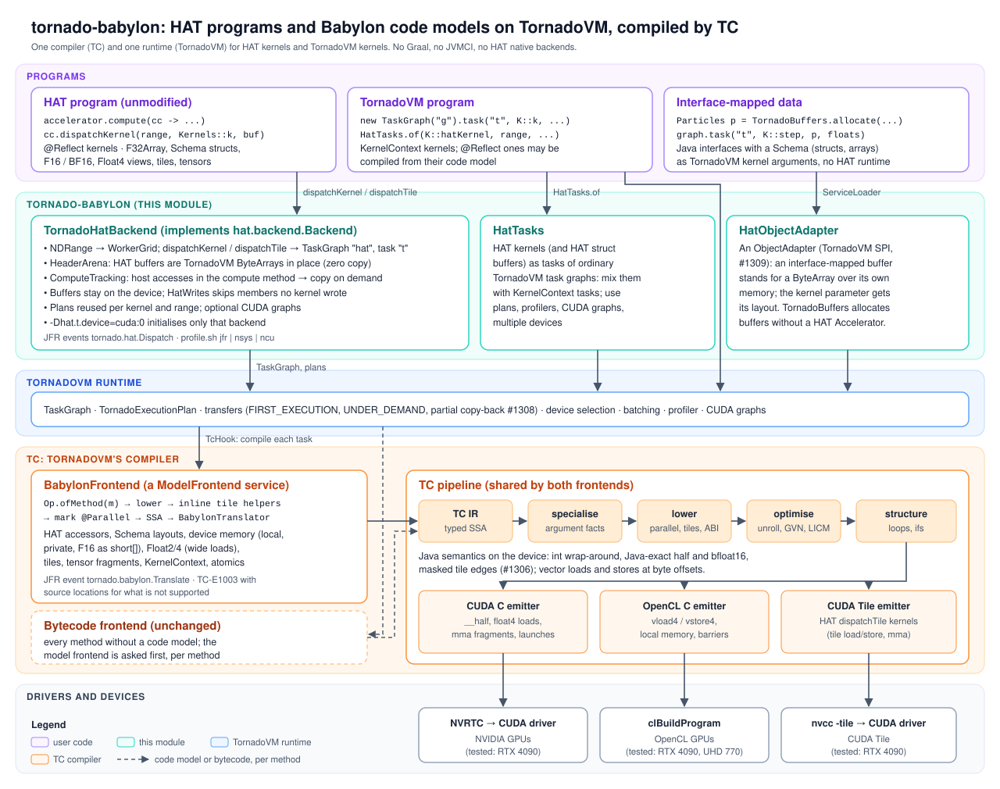

# tornado-babylon: Babylon code models and HAT programs through TC

[Project Babylon](https://openjdk.org/projects/babylon/) gives Java *code reflection*: a method
annotated `@Reflect` carries its **code model** (`jdk.incubator.code`), a typed SSA form of its body
that tools can read and transform at run time. HAT (Heterogeneous Accelerator Toolkit) is Babylon's
GPU programming model built on it. This module lets TornadoVM consume both:

1. **A TC frontend from code models.** `BabylonFrontend` (a `ModelFrontend` service) turns a
   method's code model (lowered, SSA) into TC IR, and the rest of TC is unchanged (specialisation,
   ABI, optimisation, structuring, CUDA / OpenCL / CUDA Tile emission).
2. **TornadoVM kernels from their code models.** With `-Dtornado.tc.frontend=babylon`, any
   TornadoVM task whose method has a code model (`@Reflect`) is compiled from it rather than from
   its bytecode. The whole TornadoVM unit-test suite runs this way with the same results as the
   bytecode frontend (see [Testing](#testing)).
3. **A HAT backend.** `TornadoHatBackend` implements HAT's `hat.backend.Backend`, so unmodified HAT
   programs (`Accelerator`, `ComputeContext.dispatchKernel` / `dispatchTile`, `F32Array`, ...) run
   on TornadoVM devices, compiled by TC.

Nothing here imports Graal or JVMCI, and no native code is involved: HAT's own native backends are
not used. TC is the only compiler.

## HAT kernels in TornadoVM task graphs

`HatTasks` puts HAT kernels, over HAT buffers and their structs, into ordinary TornadoVM task graphs.
They run next to other tasks, with TornadoVM's transfers, grid schedulers and execution plans, CUDA
graphs included (`examples/src/hattasks/NBodyTaskGraph.java`):

```java
var accelerator = new Accelerator(MethodHandles.lookup(), Backend.FIRST); // TornadoHatBackend
Universe universe = Universe.create(accelerator, n);                      // HAT buffer of Body structs
F32Array energy = F32Array.create(accelerator, n);

var hat = HatTasks.on(accelerator);
var graph = new TaskGraph("nbody").transferToDevice(DataTransferMode.FIRST_EXECUTION, hat.of(universe));
hat.task(graph, "accelerate", NBodyTaskGraph::accelerate, universe, 1f, 0.005f);   // @Reflect HAT kernels
hat.task(graph, "move", NBodyTaskGraph::move, universe, 0.005f);
hat.task(graph, "energy", NBodyTaskGraph::energy, universe, energy);
graph.transferToHost(DataTransferMode.EVERY_EXECUTION, hat.of(energy));

var grid = new GridScheduler("nbody.accelerate", new WorkerGrid1D(n));
grid.addWorkerGrid("nbody.move", new WorkerGrid1D(n));
grid.addWorkerGrid("nbody.energy", new WorkerGrid1D(n));
try (var plan = new TornadoExecutionPlan(graph.snapshot())) {
    plan.withDevice(TornadoExecutionPlan.getDevice(1, 0)).withGridScheduler(grid).withCUDAGraph();
    for (int s = 0; s < steps; s++) {
        plan.execute();
    }
}
```

`hat.of(buffer)` is the buffer's TornadoVM object, over its memory in place, and the same object every
time. RTX 4090, 4096 bodies: 0.311 ms a step, or 0.259 ms with a CUDA graph. Results match plain Java
to 4.8e-7 (relative), on CUDA, OpenCL and the UHD 770.

## How it fits



<details>
<summary>The call path, in text</summary>

```
HAT program ──Accelerator──▶ TornadoHatBackend.dispatchKernel / dispatchTile
                              │  NDRange → WorkerGrid; HAT buffers → ByteArray in place (HeaderArena)
                              ▼
                     TaskGraph("hat").task("t", <kernel as TaskN>, args) → TornadoVM runtime
                              │
TornadoVM program ───────────▶│ TcHook → TcCompiler.compileJava
                              ▼
                 Frontend.translateWithCallees ── asks each ModelFrontend first
                              │                       └─ BabylonFrontend: Op.ofMethod → lower → (inline tile helpers)
                              │                          → mark @Parallel → SSA → BabylonTranslator → TC IR
                              ▼
                 TC pipeline (unchanged) → CUDA C / OpenCL C / CUDA Tile C++ → NVRTC / clBuildProgram / nvcc -tile
```

</details>

## What is supported

**Java, as the bytecode frontend compiles it.** Arithmetic, comparisons, conversions (with Java's
saturating float-to-int), `&&`/`||`/ternaries, loops (`for`, `while`, enhanced `for`, `break`,
`continue`), `switch`, static calls into `@Reflect` methods (translated from their models) and into
anything else (translated from bytecode: `TornadoMath`, `java.lang.Math` bodies, `Integer.bitCount`,
user helpers), calls on objects (vectors, collections) and enums (as ordinals), static final
constants, enum constants, fields of object parameters, Java arrays, `new T[n]` private arrays,
`Debug.printf`.

**The TornadoVM API.** Native arrays, `KernelContext` (thread indices, barriers,
`allocate*LocalArray`, atomics, warp votes, tensor-core MMA fragments under the bytecode frontend's
rules), `@Parallel` loops (code models do not keep annotations on locals: the frontend reads them from
the class file and marks the loop), `@Reduce`, `HalfFloat`, the vector types and vector collections
(including in-place updates of vector parameters), `AtomicInteger`, `TileContext` (CUDA Tile) and
dynamic parallelism (`KernelContext.launch` with a `static final DeviceKernel`).

**HAT.**

| HAT feature | How |
|---|---|
| `KernelContext.GIX()` … `BSZ()`, `barrier()` | TC thread intrinsics |
| Buffers (`S32Array`, `F32Array`, `F16Array`, …, user `Buffer`s such as `ComplexArray`) | loads and stores at the offsets of each buffer's *bound* layout |
| Structs in buffers (`input.complex(k).real()`) | a view (buffer, offset, layout) with no IR value of its own |
| `arrayView()` (1D and 2D), `localArrayView()`, `privateArrayView()` | Java arrays over HAT memory, indexed as HAT's backends index them (`arr[i][j]` is `array[j * stride + i]`) |
| Local and private memory (`createLocal()`, `createPrivate()`) | shared or private memory laid out from the type's `deviceSchema`: arrays, structs, arrays of structs (`DeviceLayouts`) |
| `F16`, `BF16` | `f16`, and bfloat16 as the bits in an int; arithmetic in f32 and rounded back exactly as the Java bodies round (bfloat16: to nearest even, in integer arithmetic) |
| `Float2`, `Float4` (`float4View`, `storeFloat4View`, `float4ArrayView`, lanes, `of`, `makeMutable`, `add`/`sub`/`mul`/`div`) | TC vectors; a mutated vector (`vA.x(v)`) lives in a private slot. f32 views of buffers are one 64/128-bit access where the address is aligned (CUDA), `vloadn`/`vstoren` on OpenCL |
| `HATMath` (`maxf16`, `cosf`, `native_sinf`, …) | TC math intrinsics at the argument's precision |
| Tiles (`TileContext.load/store/index/shape/irange/BIDX`, `Tile.zeros/full/add/sub/mul/truediv/mma/transpose/sum/min/max/numTiles/ceildiv/arange/reshape/permute`) | CUDA Tile through TC's `tile.*` IR: a tensor is a strided view past HAT's header; 1D tiles are 1 x n; elementwise operations broadcast extents of 1 (a (1, n) row over an (m, n) tile); tiles at the edge of a tensor are masked (zero-padded reads, no writes past it); helpers that take tiles are inlined |
| `dispatchTile` | one CUDA Tile block per tile, numbered as HAT's backends number them (a warp flag on X flattens them) |
| `Tensor` (16 x 16 x 16 F16 multiply-accumulate: `create`/`zeros`/`fill`, `loadF16` and `store` row- or column-major, `mma`), `WRS()` | two m16n8k16 tensor-core operations per `mma`; operand fragments are loaded where the `mma` uses them (as A or B), accumulators live in a private slot; column-major loads and stores are TC intrinsics added for this (`tornado.mma.load_a.global_col`, `load_b.global_col`, `store_col`). CUDA only |

## High-priority milestones

1. **Done: HAT buffers stay on the device between dispatches.**
   - **How it works:**
     - The backend injects buffer tracking into compute methods (`ComputeTracking`).
     - A buffer is uploaded only when the host has written it, or when another kernel's plan holds the current copy.
     - It comes back when the host reads it.
     - When the compute method returns, results are copied back (with `HAT=MC`, only when the program asks: `accelerator.preAccess(buffer)` or `cc.copyOutOnExit(...)`).
   - **TornadoVM fixes this needed** (#1308): copies back on demand came from the graph's device instead of the task's, and a partial copy back made every later copy of the object partial.

2. **Done: a low-overhead dispatch path for HAT's compute loops.**
   - **Member-level analysis.** The translator records which members of each HAT buffer a kernel writes, through the helpers it passes buffers to (`HatWrites`). A host read of a member no kernel wrote needs no copy at all: Life's `grid.width()` between generations. A read of a scalar member that was written copies back only that member's bytes.
   - **CUDA graphs:** `-Dtornado.hat.cudaGraph=true` launches each kernel's plan through a CUDA graph. HAT's tests pass 154/156 with it, as without.
   - **Results** (`LifeBench`, 1024 x 1024, RTX 4090, best of 30 rounds of 100 generations; every grid identical to Java's):

     | Backend | Generations per second |
     |---|---:|
     | TornadoVM, copies every dispatch (`-Dtornado.hat.resident=false`) | 3914 |
     | TornadoVM, now | **17653** |
     | TornadoVM, `HAT=MC` | **20174** |
     | TornadoVM, CUDA graphs | 19501 |
     | HAT's CUDA backend | 2332 |
     | HAT's CUDA backend, `HAT=MC` | 4841 |

   - **What remains:** a generation costs about 50 µs against a 7 µs kernel. Most of it is the synchronisation of each blocking execution, since the host updates the control struct between generations. Going further needs asynchronous executions in TornadoVM.
   - **Options:** `-Dtornado.hat.resident=false`, `-Dtornado.hat.memberCopies=false`, `-Dtornado.hat.traceResidency=true`, `-Dtornado.hat.cudaGraph=true`.

3. **Done: Game of Life with its window.**
   - `lifebench.LifeWindow` runs HAT's `life` demo as `life.Main` does: the real Swing `Viewer`, the demo's pattern (a 10018 x 6798 grid) and its compute loop. The loop refreshes the window at its frame rate (5 frames per second) and runs generations in between. The harness skips the start button and reports generations per second over 10 s.
   - **Results** (RTX 4090, window on an X server):

     | Backend | Generations per second |
     |---|---:|
     | TornadoVM | **2409** |
     | TornadoVM, `HAT=MC` | 2399 |
     | TornadoVM, copies every dispatch | 65 |
     | HAT's CUDA backend | 53 |
     | HAT's CUDA backend, `HAT=MC` | 103 |

     At this size a copy is 68 MB, so keeping the grid on the device is what counts. The window's refresh copies the grid back and re-uploads it 5 times per second.
   - **Run it without a display:** use Xvfb, here in a container that shares its X socket:
     ```bash
     docker run -d --name hat-xvfb --rm -v /tmp/.X11-unix:/tmp/.X11-unix ubuntu:22.04 \
         bash -c "apt-get update -qq && apt-get install -y -qq xvfb && Xvfb :77 -screen 0 1600x1200x24 -ac -nolisten tcp"
     H=$BABYLON/hat/build
     DISPLAY=:77 ./run.sh -d 1:0 $H/hat-example-life-1.0.jar:$H/hat-example-shared-1.0.jar:build/examples lifebench.LifeWindow 10
     ```

4. **Done: interface-mapped data in TornadoVM's API.**
   - HAT's interface-mapped buffers can be passed to TornadoVM as they are, with no `HatTasks` and no HAT `Accelerator`:
     - to `TaskGraph.task` (as arguments of TornadoVM kernels);
     - to `transferToDevice` and `transferToHost`;
     - to `TornadoExecutionResult.transferToHost` and `TornadoExecutionPlan.transferToDevice`.
   - Buffers are Java interfaces with a `Schema`, structs included, and no layout written by hand.
   - **How:** TornadoVM's new `ObjectAdapter` service (its own PR, #1309) lets a library stand objects in for TornadoVM objects. This module installs `HatObjectAdapter`: a buffer becomes a `ByteArray` over its own memory, and the kernel parameter that receives it gets its layout, so TC compiles the kernel's accessors from its code model. `TornadoBuffers.allocate` allocates such buffers for TornadoVM.
   - **Example** (`examples/src/interfacemapped/InterfaceMappedParticles.java`):
     ```java
     public interface Particles extends Buffer {
         int length();
         interface Particle extends Struct { float x(); float y(); float vx(); float vy(); void x(float x); /* ... */ }
         Particle particle(long index);
         Schema<Particles> schema = Schema.of(Particles.class, p -> p.arrayLen("length").array("particle", q -> q.fields("x", "y", "vx", "vy")));
     }

     @Reflect
     public static void step(KernelContext context, Particles particles, float dt) {   // a TornadoVM kernel
         Particles.Particle p = particles.particle(context.globalIdx);
         p.x(p.x() + p.vx() * dt);
         // ...
     }

     Particles particles = TornadoBuffers.allocate(MethodHandles.lookup(), Particles.schema, n);
     var graph = new TaskGraph("particles")
             .transferToDevice(DataTransferMode.FIRST_EXECUTION, particles)
             .task("step", InterfaceMappedParticles::step, new KernelContext(), particles, dt)
             .task("energy", InterfaceMappedParticles::energy, new KernelContext(), particles, energy)   // energy: a FloatArray
             .transferToHost(DataTransferMode.UNDER_DEMAND, particles);
     ```
     100,000 particles, 50 steps: identical to Java within 8.7e-8 on CUDA, OpenCL RTX 4090 and OpenCL UHD 770.

## Current limitations

**In this module (TornadoVM and TC):**

- **CUDA only:** CUDA Tile (`dispatchTile`) and tensor-core (`Tensor`) kernels run on CUDA devices only. Elsewhere TC refuses them with TC-E4010 or TC-E4002.
- **Power-of-two tile extents (TC-E3401).** This is a CUDA Tile rule. To reduce a whole row or column of any length, load it as the next power of two; the edge is zero-padded (`examples/src/tiles/TileExamples.java`, `rowSum`).
- **`Tile.permute`:** only the identity and the 2D transpose (1, 0).
- **`Tile.arange`:** yields F32 values.
- **HAT's 2DREGISTERTILING_V is 1.5x slower** than with HAT's CUDA backend (121 vs 80 µs). The cause is not the `Float4` loads (now one 128-bit access, below): NVRTC unrolls TC's 16-iteration loop over the shared-memory tiles 4 times, and HAT's C fully (8 against 32 `LDS.128`; ncu: 8.4M shared-load bank conflicts against 0). The loop is too large for TC's own unroller before lowering; `#pragma unroll` on it gives HAT's code. An automatic hint is not done yet.
- **HAT tensors:** an operand is loaded where `mma` uses it, not where `loadF16` is called.
- **Double precision:** kernels that use it are refused on devices without FP64 (TC-E4012), for example `Math.exp` on doubles on an Intel UHD 770.
- **First dispatch:** 0.5-0.6 s for the plan, TC and NVRTC (or nvcc for CUDA Tile); HAT's own CUDA backend takes 0.16-0.23 s. Later dispatches reuse the plan. While a plan is built, a kernel's code model is translated up to three times (access analysis, loop-index check, compilation), about 2 ms each once warm.
- **`HatTasks`:** buffers must come from an `Accelerator` on `TornadoHatBackend`. A kernel is a method reference to a static `@Reflect` method; a lambda is refused with a clear message.
- **`@Parallel` loops** in TornadoVM kernels compiled from their code models need class files compiled with `-g`.

- **Buffer residency:**
  - It pays when buffers stay on the device across dispatches (Game of Life). A kernel whose launches all have to upload every buffer again (one dispatch per compute call, as HAT's matmul) switches to an ordinary plan after 4 launches, whose transfers run inside the execution from pinned memory: 1.49 ms per compute of 2DTILING (1024), against 1.94 ms resident.
  - Host accesses are tracked in the compute method HAT dispatches (as HAT's own backends do). A call from it to another method that receives buffers counts as writing them.
  - A kernel that writes a buffer through array views, vector stores, tiles or atomics, or a helper compiled from bytecode, counts as writing all of that buffer.

**In HAT itself** (HAT's own checks, before any backend; the same on HAT's CUDA and OpenCL backends):

- A literal written in a `compute` lambda arrives as `null`; only captured values are passed. Use variables: `int tile = 256; accelerator.compute(cc -> k(cc, a, tile))`.
- Tile kernels cannot take `float` parameters (`Illegal parameter type float`).
- HAT's tile type checker refuses:
  - a tile times a scalar (`Tile.mul(tile, 0.5f)`);
  - `Tile.truediv` of two tiles;
  - `Tile.max(tile, axis)`;
  - an `arange` tile combined with a loaded tile.

  Tile-by-tile `add`/`sub`/`mul`, `sum` over each axis, `mma`, `transpose`, `reshape` and `permute` pass the checker.
- `TestNbody` updates body positions inside the kernel that also reads them (a race). Its expected-precision result is the same on HAT's own backends.
- Babylon is an OpenJDK project branch, not a JDK release, and HAT's API is still changing. This module is tested with `code-reflection` at `87aaaa4b0`.

## Build and run

Tested on Linux x86-64 with an RTX 4090 (CUDA 12.6 toolkit, driver for CUDA 13) and an Intel UHD 770.

**1. A Babylon JDK** ([openjdk/babylon](https://github.com/openjdk/babylon), branch `code-reflection`;
tested at `87aaaa4b0`). Its boot JDK is JDK 26:

```bash
git clone -b code-reflection https://github.com/openjdk/babylon.git ~/src/babylon
cd ~/src/babylon
bash configure --with-boot-jdk=$HOME/.sdkman/candidates/java/26.0.1-open   # e.g. sdk install java 26.0.1-open
make images                         # build/linux-x86_64-server-release/images/jdk
```

**2. HAT**, in the same checkout, with that JDK (needs Maven and CMake):

```bash
cd ~/src/babylon/hat
JAVA_HOME=~/src/babylon/build/linux-x86_64-server-release/images/jdk mvn clean package   # jars in hat/build
```

**3. This TornadoVM branch**, with JDK 25 (`sdk install java 25.0.2-open`):

```bash
cd TornadoVM                                  # this branch
export JAVA_HOME=~/.sdkman/candidates/java/25.0.2-open
make jdk22plus BACKEND=opencl,cuda            # or BACKEND=opencl / BACKEND=cuda
source setvars.sh
```

**4. Build this module and run.** `env.sh` points at the Babylon checkout: set `BABYLON=~/src/babylon`
(default `~/src/babylon-new`), or `BABYLON_JDK=` to a built Babylon JDK.

```bash
cd tornado-babylon
export BABYLON=~/src/babylon
./build.sh                                    # build/tornado-babylon.jar + build/examples
tornado --devices                             # driver:device numbers; here CUDA is 1:0, OpenCL 0:0 / 0:1

# An unmodified HAT program on TornadoVM:
H=$BABYLON/hat/build
./run.sh -d 1:0 $H/hat-example-matmul-1.0.jar:$H/hat-example-shared-1.0.jar matmul.Main --kernel=2DTILING --check --size=256

# HAT's own unit tests on TornadoVM (all of them, or some classes):
./hat-tests.sh -d 1:0
./hat-tests.sh -d 0:0 TestMatMul TestFlashAttention

# TornadoVM @Reflect kernels compiled from their code models:
source ./env.sh
java @build/tornado.args --enable-preview --add-modules=jdk.incubator.code -Dtornado.tc.frontend=babylon \
     -cp build/tornado-babylon.jar:build/examples reflect.ReflectKernels
```

Options:
- `-Dtornado.tc.frontend=auto` (default: code models for HAT kernels; HAT kernels have no other way
  in), `babylon` (every method with a code model) or `bytecode` (off).
- `-Dhat.t.device=<backend>:<device>` picks the HAT backend's device, by the backend's name (`cuda:0`, `opencl:1`) or index (`1:0`). With a name, only that backend is initialised, which takes about 0.2 s off the first dispatch of a CUDA run (no OpenCL set-up).
- `-Dtornado.hat.zeroCopy=false` copies HAT buffers around each dispatch instead of wrapping them in
  place.
- `-Dtornado.hat.strictFP=true` gives the plans strict floating point.
- `-Dtornado.babylon.dumpModels=true` prints each lowered model as TC reads it.

`@Parallel` through code models needs the class file's local variable names: compile with `-g`
(Maven's default).

## Files in this module

| File | What it is |
|---|---|
| `src/main/java/.../babylon/tc/` | The TC frontend: `BabylonFrontend` (the `ModelFrontend` service), `BabylonTranslator` (code model to TC IR), `HatLayouts` / `DeviceLayouts` (HAT schemas as memory layouts), `HatWrites` (members each kernel writes), `Markers` |
| `src/main/java/.../babylon/hat/` | The HAT backend: `TornadoHatBackend`, `HeaderArena`, `ComputeTracking`, `HatTasks`, `HatObjectAdapter` (+ its thin `HatObjectAdapterService`), `TornadoBuffers` |
| `src/main/java/.../babylon/Events.java` | JFR events: `tornado.hat.Dispatch`, `tornado.babylon.Translate` |
| `examples/src/` | Self-checking examples: `@Reflect` TornadoVM kernels, `HatTasks`, tiles, Game of Life (headless and windowed), interface-mapped particles |
| `docs/architecture.svg` | The diagram above |
| `build.sh`, `env.sh` | Build the module and its examples with the Babylon JDK; the environment they use |
| `run.sh` | Run a HAT or TornadoVM program through this module (`-d cuda:0`) |
| `hat-tests.sh`, `hat-sweep.sh` | HAT's unit tests and HAT's examples on TornadoVM devices |
| `examples-tests.sh` | This module's examples on every device |
| `reflect-all-sdk.sh`, `annotate-static-methods.py` | The TornadoVM unit-test suite compiled from code models: an SDK copy whose test kernels are `@Reflect` |
| `perf.sh`, `perf-nsys.sh` | End-to-end and kernel-only times against HAT's own backends |
| `profile.sh`, `tools/` | JFR, Nsight Systems and Nsight Compute runs, with their summaries (`jfr-summary.py`, `ncu-summary.py`, `profile.jfc`) |
| `checkstyle.sh` | TornadoVM's checkstyle rules on this module (it is built outside the Maven reactor) |

## Testing

| Script | What it runs |
|---|---|
| `./hat-tests.sh [-d dev] [Class[#method] ...]` | HAT's own unit tests (`hat/tests`, through HAT's test engine) on TornadoVM; a class whose JVM dies is rerun one method per JVM |
| `./hat-sweep.sh [dev ...]` | HAT's example programs, validated by their `--check` or against HAT's own CUDA output |
| `./reflect-all-sdk.sh` | a copy of the SDK whose unit tests are compiled by Babylon's javac with every static method `@Reflect`, to run the whole TornadoVM unit-test suite with kernels from their code models |
| `./examples-tests.sh [dev ...]` | the self-checking examples on every device: `ReflectKernels` (with and without a CUDA graph), `HatTasksChecks` (10 checks of HAT kernels in task graphs: next to plain TornadoVM tasks, shared buffers, 2D, CUDA graphs, misuse), `NBodyTaskGraph`, and `TileExamples` (10 tile kernels at 256 and at a ragged 1000, CUDA only) |

### HAT's unit tests (156 tests in 30 classes)

| Device | TornadoVM (TC) | HAT's own backend |
|---|---|---|
| RTX 4090, CUDA | **154** pass, 2 expected-precision (the values HAT's own backends give) | 130 pass, 6 fail, 4 expected-precision, some classes not launched |
| RTX 4090, OpenCL | **135** pass, 2 expected-precision; 15 tile and 4 tensor tests refused (CUDA only) | 133 pass, 21 fail, 2 expected-precision |
| Intel UHD 770, OpenCL | **132** pass; the rest are tiles and tensors (CUDA only) and 4 kernels using `Math.exp` in double precision on a device without FP64 (TC-E4012) | not run |

The expected-precision tests (`test_bfloat16_14`, `testNbody`) give exactly the values HAT's own
backends give.

### The TornadoVM unit-test suite from code models

`reflect-all-sdk.sh` + `tc-diff` with `-Dtornado.tc.frontend=babylon`, RTX 4090 CUDA: **1627 of 1627
passing tests pass**, the same as the bytecode frontend on the same SDK, JDK and devices. Output and
launch configurations are compared test by test.

### HAT's examples (`hat-sweep.sh`, RTX 4090 CUDA)

squares, mandel, matmul (MT, 1D, 1DFC, 2D, 2DLI, 2DTILING, 2DREGISTERTILING,
2DREGISTERTILING_V, 2DREGISTERTILING_FP16, strict-FP FP16), dft, flash-attention and tensors pass.
matmul 2DLIF16 prints the same values as HAT's own OpenCL backend (`66.481575 != 63.870296`): the
example's check ignores the F16 rounding of each product. HAT's CUDA backend is further off.

## Profiling

`profile.sh` runs any HAT program, or TornadoVM program through this module, under a profiler, and
prints a summary. The recordings stay in `build/profile/`.

```bash
H=$BABYLON/hat/build
CP=$H/hat-example-matmul-1.0.jar:$H/hat-example-shared-1.0.jar
./profile.sh jfr  -d 1:0 $CP matmul.Main --kernel=2DTILING --size=512 --iterations=20
./profile.sh nsys -d 1:0 $CP matmul.Main --kernel=2DTILING --size=512 --iterations=20
NCU_COUNT=5 ./profile.sh ncu -d 1:0 $CP matmul.Main --kernel=2DTILING --size=512 --iterations=5
```

- **JFR.** This module records two events:
  - `tornado.hat.Dispatch`: kernel, range, tile or not, and whether this dispatch built the plan;
  - `tornado.babylon.Translate`: kernel and code-model size.

  Together with TornadoVM's `tornado.Compile` (where the SDK records it) and CPU samples, the summary looks like:
  ```
  HAT dispatch                                     n   first ms  later mean ms  later min ms
  Main.matrixMultiplyKernel2DTiling               20     470.03          0.386         0.340
  code models translated: 3, 20.6 ms in total
  CPU samples: TornadoVM runtime/driver 49%, application/JDK 31%, HAT core 9%, Babylon code reflection 7%, TC compiler 3%, HAT backend 1%
  ```
  The recording also opens in JDK Mission Control.
- **Nsight Systems:** GPU kernel and CUDA API tables. Kernels carry TC's names, `<Class>_<method>`, for example `Main_matrixMultiplyKernel2DTiling`.
- **Nsight Compute:** per kernel, duration, SM and DRAM throughput, achieved occupancy and registers per thread. For example, 2DTILING at 512: 46.9 µs, SM 85.8%, DRAM 4.6%, occupancy 74.8%, 39 registers. `NCU_KERNEL=<regex>` selects kernels.

## Performance

HAT's matrix-multiply example, 1024 x 1024 floats, RTX 4090, 30 iterations (`perf-nsys.sh`, `perf.sh`):
the same HAT kernels compiled by TC on TornadoVM, and by HAT's own CUDA and OpenCL backends.

| Kernel | TC kernel time (CUDA) | HAT CUDA kernel time | TC end to end, median | HAT CUDA end to end | HAT OpenCL end to end |
|---|---:|---:|---:|---:|---:|
| 1D | 17.8 ms | 37.0 ms | 18.8 ms | 37.7 ms | 397 ms |
| 2D | 1.79 ms | 1.76 ms | 2.98 ms | 3.00 ms | 351 ms |
| 2DLI | 428 µs | 443 µs | 1.60 ms | 1.62 ms | 65.1 ms |
| 2DTILING | 332 µs | 333 µs | 1.49 ms | 1.49 ms | 29.0 ms |
| 2DREGISTERTILING | 79.2 µs | 75.9 µs | 1.23 ms | 1.18 ms | 11.4 ms |
| 2DREGISTERTILING_V | 121 µs | 79.6 µs | 1.29 ms | 1.18 ms | 8.7 ms |
| 2DREGISTERTILING_FP16 | 74.8 µs | 58.9 µs (result wrong) | 0.78 ms | 0.75 ms (wrong) | 7.8 ms |

- Kernel time is the mean of Nsight Systems' CUDA kernel records; end to end is the example's own
  timing of a dispatch, including transfers. TornadoVM on OpenCL (same GPU) takes 1.03-1.48x its CUDA
  end-to-end times.
- The kernels are on par except three. **1D** is 2.1x faster with TC (not investigated). **2DREGISTERTILING_V** is 1.5x slower: not
  its `Float4` loads, which are one 128-bit access, but a loop NVRTC unrolls less than HAT's (see Current limitations). **FP16** is
  1.26x slower (74.7 vs 59.2 µs): TC rounds the product and the sum separately, as `F16.mul` and `F16.add` do in Java,
  while HAT's C lets nvcc fuse them (`HFMA2`), and HAT's result fails the example's check. (It was 3.4x slower, 202 µs,
  while HAT's half arrays were stored as 64-bit words: nvcc packed and unpacked every half, 912 SASS instructions against
  392 now that they are `short[]`.)
- First dispatch of 2DTILING (1024), `-d cuda:0`, median of 5 runs: **270 ms** on TornadoVM against **168 ms** with HAT's
  CUDA backend; the whole program, launch to exit, **590 ms** against **470 ms**. HAT's backend creates its CUDA context
  when the `Accelerator` is built, before its first dispatch; `TornadoHatBackend` now initialises TornadoVM and the device on a
  background thread from that moment too (`-Dtornado.hat.warmUp=false` turns it off: 354 ms and 677 ms). The CUDA module
  cache saves only 27 ms here (381 ms with it cleared). With every backend enabled (`-d 1:0`), OpenCL's set-up adds
  about 0.2 s; `cuda:0` initialises only CUDA. Translating the code model is 20 ms. Later dispatches reuse the plan.
