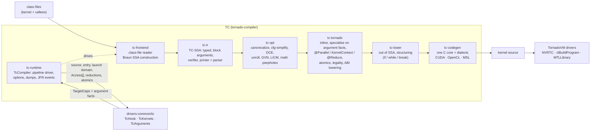

# TC: the TornadoVM compiler

TC compiles TornadoVM kernels, Java methods, to **CUDA C++** (NVRTC), **OpenCL C 1.2** and **Metal
Shading Language**. It reads the class files itself, works on its own SSA IR, and prints structured
source that the device driver compiles. It is pure Java (JDK 21+). It uses no JVMCI, no Graal and no
bindings to LLVM, MLIR or NVVM. It runs headless: no GPU and no TornadoVM runtime are needed to
compile.

TC replaced the vendored Graal compiler. The design proposal is
[beehive-lab/TornadoVM#1227](https://github.com/beehive-lab/TornadoVM/issues/1227). The full design,
the migration record and its measurements are in
[mikepapadim/tornado-compiler-spec](https://github.com/mikepapadim/tornado-compiler-spec).

## Architecture



| Module | Role |
|---|---|
| `tc-ir` | TC-SSA: types (`i1`…`i64`, `f16`/`bf16`/`f32`/`f64`, vectors, pointers with NVPTX address spaces), block arguments instead of phis, the Tornado intrinsic registry, the verifier, the textual printer and parser, dominators and loops. `TargetCaps` describes what a device offers. |
| `tc-frontend` | Reads class files (no `java.lang.reflect` or class loading needed) and builds SSA on the fly (Braun et al. 2013). It keeps Java names, lines and bcis on every value. It resolves TornadoVM API calls through a binding table. |
| `tc-opt` | A pass manager and the target-independent passes. Every pass is verified in tests. |
| `tc-tornado` | The TornadoVM semantics: inlining, specialisation on argument facts (array lengths, scalars, object layouts), `@Parallel` loops into grid-stride loops, `KernelContext`, reductions, atomics, legality per target, and the ABI lowering to the runtime's buffers. It also provides `AccessAnalysis` (the `Access[]` of each parameter). |
| `tc-lower` | SSA destruction and dominator-based structuring (Ramsey 2022) into TC-S, a structured IR. Irreducible control flow gets a diagnostic, not a `goto`. |
| `tc-codegen` | One C-family printer (statements, precedence, Java integer semantics) and thin dialects for CUDA, OpenCL and MSL. The output keeps Java names and `// File.java:N` comments. |
| `tc-runtime` | `TcCompiler.compileJava(...)`: the pipeline, options (`TcOptions`), stage timings, dumps and JFR events. Also `tools/Tc`, the headless `tc` command line. |
| `tc-debug` | The per-compilation HTML report. |
| `tc-check` | LLVM-style test tools in Java: FileCheck, a lit runner, and `SourceRules` (the clean-room and hygiene guard). |
| `tc-gpu` | End-to-end checks on a real device (`DesignTest`), outside the headless build. |

### Design choices

- **Block arguments, not phis** (MLIR style). SSA destruction is edge copies, and the IR maps
  one-to-one onto LLVM IR or MLIR `cf` should an interop printer be wanted.
- **Structured output.** The target is source code for a driver compiler, so TC structures control
  flow itself instead of emitting a CFG and patching it with `goto`s.
- **One C core, thin dialects.** A new target is a dialect (types, address spaces, intrinsic
  spellings, preamble) plus `TargetCaps`. Passes and lowering are shared.
- **Specialisation on facts.** The runtime hands TC what it knows about the actual arguments (array
  lengths, scalar values, object layouts). TC folds them, so kernels are compiled per argument shape,
  as the runtime always did.
- **Stable diagnostics.** A kernel TC cannot compile gets a code (`TC-E1xxx` frontend, `E2xxx`
  IR/verifier, `E3xxx` Tornado lowering, `E4xxx` target, `E9xxx` internal), the Java line and bci, and
  a hint. The runtime turns the code's category into the matching TornadoVM exception.
- **Clean-room.** No code is taken from Graal, LLVM, MLIR or HAT. Algorithms are implemented from
  their publications ([provenance](https://github.com/mikepapadim/tornado-compiler-spec/blob/main/compiler-replacement/provenance.md)). Every module's
  `SourceRulesTest` fails the build on a Graal, JVMCI, GraalVM SDK or ASM import.

### How the runtime uses it

`tornado-drivers/drivers-common/.../tc/`:

- `TcKernels` is called by each driver's `compileTask`.
- `TcArguments` turns the task's arguments into facts. Object layouts come from the runtime's
  `FieldLayout`, which is TornadoVM's own device layout, independent of the JVM's.
- `TcHook` sets each device's `TargetCaps` from the device's own queries and installs the source
  through the driver's install path.
- `TcAccessProvider` gives the runtime the parameter accesses and reductions it needs to build the
  task graph.

## Running the compiler-only tests

The TC modules are headless, so their tests (JUnit API tests plus 76 lit file tests) run on
every Maven build of `tornado-compiler`, unlike the GPU suites:

```bash
source setvars.sh
# every TC module with its tests (about 10 s; 143 test cases, the lit file tests included)
./mvnw -o -Pjdk22plus -pl $(ls -d tornado-compiler/tc-* | paste -sd,) -am install
# one module, or one file test
./mvnw -o -Pjdk22plus -pl tornado-compiler/tc-ir -am test
./mvnw -o -Pjdk22plus -pl tornado-compiler/tc-ir -am test -Dtest='LitTest#run[Verifier/types.tcir]' -Dsurefire.failIfNoSpecifiedTests=false
```

The profile follows `JAVA_HOME`: `-Pjdk21` on JDK 21, `-Pjdk22plus` on JDK 22 or newer. File
tests live in `tc-*/src/test/lit/<Area>/*.tcir`, with `RUN:` lines and FileCheck `CHECK:` lines. `utils/update-checks.py <test>` regenerates a test's
CHECK block; review the diff by hand. The layout and directives are described in
[testing.md](https://github.com/mikepapadim/tornado-compiler-spec/blob/main/compiler-replacement/testing.md).

The emitted source of the CUDA, OpenCL and Metal file tests is also compiled by the device's own
compiler when it is installed: `nvcc` (PTX), `utils/clbuild` (the OpenCL driver), `utils/metalc`
(Apple's Metal compiler, on a Mac: `clang -fobjc-arc -O2 -o metalc metalc.m -framework Metal
-framework Foundation`) and `utils/mslcheck` (MSL against a mock `metal_stdlib`, anywhere). A `RUN:`
line whose tool is missing is skipped.

The GPU suites (`tornado-test`) cover TC through the runtime. The regression harness
[`tc-diff.py`](utils/tc-diff.py) runs them per device and compares
each test and each launch configuration with an earlier run:

```bash
python3 tornado-compiler/utils/tc-diff.py run --device 1:0 --out ~/tc-diff/new --against ~/tc-diff/old
```

## Tools

**`tc emit`**, the headless compiler, ships in the SDK's `bin/`. It needs no GPU:

```bash
tc emit [--target cuda|opencl|metal] [--cp <class path>] [--stats] <Class> <method>
tc emit --target opencl --cp my-kernels.jar com.example.Kernels saxpy
```

`build-tc-native` (with `GRAALVM_HOME` set to a GraalVM for JDK 25+) builds it as a native image,
`bin/tc-native`, which `tc` then uses. A cold compile then takes about 20 ms instead of about
200 ms, and the output is byte-identical.

**[tcirviz](https://github.com/mikepapadim/tornadovm-tcirviz)**, the IR visualiser:
`tornado --tcirviz [MyKernels.java]` opens a browser page. It shows Java → bytecode → TC IR after
every stage and every pass → structured IR → CUDA/OpenCL/MSL. Click any line or value and follow it
through every stage, and diff any stage against the previous one. It is headless, and new targets
plug in as a `Backend` service.

**Runtime options** (`-D...` with `tornado --jvm`):

| Option | Effect |
|---|---|
| `tornado.tc.verbose=true` | one line per compiled kernel, with its time |
| `tornado.tc.stats=true` | at exit: kernels compiled and refused, by diagnostic code |
| `tornado.tc.dump=all\|<stage>,...` | write the IR after each stage to `tornado.tc.dumpDir` (default `tc-dumps/`) |
| `tornado.tc.only=<Class.method>` | restrict dumps and reports to one kernel |
| `tornado.tc.report=html` | a self-contained HTML report per kernel: bytecode, every stage, the source |
| `tornado.tc.verify=end` | verify the IR once at the end instead of after every stage |
| `--printKernel` (launcher flag) | print the generated source |

## Further reading

In [mikepapadim/tornado-compiler-spec](https://github.com/mikepapadim/tornado-compiler-spec):


- [architecture.md](https://github.com/mikepapadim/tornado-compiler-spec/blob/main/compiler-replacement/architecture.md) and
  [ir-specification.md](https://github.com/mikepapadim/tornado-compiler-spec/blob/main/compiler-replacement/ir-specification.md): the IR in detail
- [backend-contracts.md](https://github.com/mikepapadim/tornado-compiler-spec/blob/main/compiler-replacement/backend-contracts.md): the kernel ABI per target
- [optimizations.md](https://github.com/mikepapadim/tornado-compiler-spec/blob/main/compiler-replacement/optimizations.md): the passes
- [parity-matrix.md](https://github.com/mikepapadim/tornado-compiler-spec/blob/main/compiler-replacement/parity-matrix.md): test parity with the Graal path, per device
- [cold-start.md](https://github.com/mikepapadim/tornado-compiler-spec/blob/main/compiler-replacement/cold-start.md): compile latency, Leyden and native image
