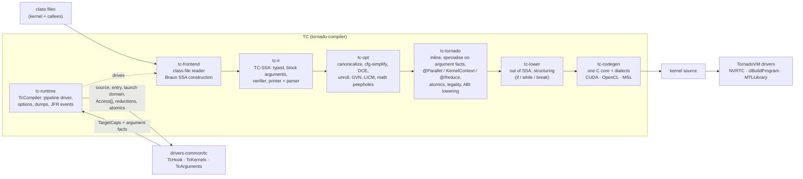

# TC: the TornadoVM compiler

TC compiles TornadoVM kernels, Java methods, to **CUDA C++** (NVRTC), **OpenCL C 1.2** and **Metal
Shading Language**. It reads the class files itself, works on its own SSA IR, and prints structured
source that the device driver compiles. It is pure Java (JDK 21+). It uses no JVMCI, no Graal and no
bindings to LLVM, MLIR or NVVM. It runs headless: no GPU and no TornadoVM runtime are needed to
compile.

TC replaced the vendored Graal compiler. The design proposal is
[beehive-lab/TornadoVM#1227](https://github.com/beehive-lab/TornadoVM/issues/1227). The full design,
the migration record and its measurements are in
[mikepapadim/tornado-compiler-spec](https://github.com/mikepapadim/tornado-compiler-spec).

## Architecture



| Module | Role |
|---|---|
| `tc-ir` | TC-SSA: types (`i1`…`i64`, `f16`/`bf16`/`f32`/`f64`, vectors, pointers with NVPTX address spaces), block arguments instead of phis, the Tornado intrinsic registry, the verifier, the textual printer and parser, dominators and loops. `TargetCaps` describes what a device offers. |
| `tc-frontend` | Reads class files (no `java.lang.reflect` or class loading needed) and builds SSA on the fly (Braun et al. 2013). It keeps Java names, lines and bcis on every value. It resolves TornadoVM API calls through a binding table. |
| `tc-opt` | A pass manager and the target-independent passes. Every pass is verified in tests. |
| `tc-tornado` | The TornadoVM semantics: inlining, specialisation on argument facts (array lengths, scalars, object layouts), `@Parallel` loops into grid-stride loops, `KernelContext`, reductions, atomics, legality per target, and the ABI lowering to the runtime's buffers. It also provides `AccessAnalysis` (the `Access[]` of each parameter). |
| `tc-lower` | SSA destruction and dominator-based structuring (Ramsey 2022) into TC-S, a structured IR. Irreducible control flow gets a diagnostic, not a `goto`. |
| `tc-codegen` | One C-family printer (statements, precedence, Java integer semantics) and thin dialects for CUDA, OpenCL and MSL. The output keeps Java names and `// File.java:N` comments. |
| `tc-runtime` | `TcCompiler.compileJava(...)`: the pipeline, options (`TcOptions`), stage timings, dumps and JFR events. Also `tools/Tc`, the headless `tc` command line. |
| `tc-debug` | The per-compilation HTML report. |
| `tc-check` | LLVM-style test tools in Java: FileCheck, a lit runner, and `SourceRules` (the clean-room and hygiene guard). |
| `tc-selftest` | `tornado-selftest`: checks TC on the devices of a machine and reports their TC capabilities ([below](#checking-tc-on-a-machine-tornado-selftest)). |

### Design choices

- **Block arguments, not phis** (MLIR style). SSA destruction is edge copies, and the IR maps
  one-to-one onto LLVM IR or MLIR `cf` should an interop printer be wanted.
- **Structured output.** The target is source code for a driver compiler, so TC structures control
  flow itself instead of emitting a CFG and patching it with `goto`s.
- **One C core, thin dialects.** A new target is a dialect (types, address spaces, intrinsic
  spellings, preamble) plus `TargetCaps`. Passes and lowering are shared.
- **Specialisation on facts.** The runtime hands TC what it knows about the actual arguments (array
  lengths, scalar values, object layouts). TC folds them, so kernels are compiled per argument shape,
  as the runtime always did.
- **Stable diagnostics.** A kernel TC cannot compile gets a code (`TC-E1xxx` frontend, `E2xxx`
  IR/verifier, `E3xxx` Tornado lowering, `E4xxx` target, `E9xxx` internal), the Java line and bci, and
  a hint. The runtime turns the code's category into the matching TornadoVM exception.
- **Clean-room.** No code is taken from Graal, LLVM, MLIR or HAT. Algorithms are implemented from
  their publications ([provenance](https://github.com/mikepapadim/tornado-compiler-spec/blob/main/compiler-replacement/provenance.md)). Every module's
  `SourceRulesTest` fails the build on a Graal, JVMCI, GraalVM SDK or ASM import.

### How the runtime uses it

`tornado-drivers/drivers-common/.../tc/`:

- `TcKernels` is called by each driver's `compileTask`.
- `TcArguments` turns the task's arguments into facts. Object layouts come from the runtime's
  `FieldLayout`, which is TornadoVM's own device layout, independent of the JVM's.
- `TcHook` sets each device's `TargetCaps` from the device's own queries and installs the source
  through the driver's install path.
- `TcAccessProvider` gives the runtime the parameter accesses and reductions it needs to build the
  task graph.

## Running the compiler-only tests

The TC modules are headless, so their tests (JUnit API tests plus 76 lit file tests) run on
every Maven build of `tornado-compiler`, unlike the GPU suites:

```bash
source setvars.sh
# every TC module with its tests (about 10 s; 143 test cases, the lit file tests included)
./mvnw -o -Pjdk22plus -pl $(ls -d tornado-compiler/tc-* | paste -sd,) -am install
# one module, or one file test
./mvnw -o -Pjdk22plus -pl tornado-compiler/tc-ir -am test
./mvnw -o -Pjdk22plus -pl tornado-compiler/tc-ir -am test -Dtest='LitTest#run[Verifier/types.tcir]' -Dsurefire.failIfNoSpecifiedTests=false
```

The profile follows `JAVA_HOME`: `-Pjdk21` on JDK 21, `-Pjdk22plus` on JDK 22 or newer. File
tests live in `tc-*/src/test/lit/<Area>/*.tcir`, with `RUN:` lines and FileCheck `CHECK:` lines. `utils/update-checks.py <test>` regenerates a test's
CHECK block; review the diff by hand. The layout and directives are described in
[testing.md](https://github.com/mikepapadim/tornado-compiler-spec/blob/main/compiler-replacement/testing.md).

The emitted source of the CUDA, OpenCL and Metal file tests is also compiled by the device's own
compiler when it is installed: `nvcc` (PTX), `utils/clbuild` (the OpenCL driver), `utils/metalc`
(Apple's Metal compiler, on a Mac: `clang -fobjc-arc -O2 -o metalc metalc.m -framework Metal
-framework Foundation`) and `utils/mslcheck` (MSL against a mock `metal_stdlib`, anywhere). A `RUN:`
line whose tool is missing is skipped.

The GPU suites (`tornado-test`) cover TC through the runtime. For a quick check of one machine,
`tornado-selftest` ([below](#checking-tc-on-a-machine-tornado-selftest)) runs a small set of kernels
on every device in a few seconds.

## Checking TC on a machine: tornado-selftest

`tornado-selftest` (in the SDK's `bin/`) answers two questions for every device TornadoVM finds:
what TC compiles for on it, and whether the code TC generates there is correct. It runs about 20
small kernels per device and compares every result with the same Java method run on the JVM. It
takes a few seconds and needs no test framework, so it works from any SDK install.

```bash
tornado-selftest                       # every device
tornado-selftest -d 1:0 -g tensor-cores # one device (as in tornado --devices), one group
tornado-selftest --list                # the checks, and what each needs
tornado-selftest --json report.json    # also write the report as JSON
```

The first line per device is the target TC compiles for, the same `TargetCaps` the compiler uses
(see `TcTargetDevice`):

```
Device 1:0: NVIDIA GeForce RTX 4090 (CUDA)
  TC target: CUDA sm_89, NVRTC 12.6, fp64 yes, fp16 yes, warp 32, local memory 48 KB, work-group 1024, tensor cores F16+FP8, device launch yes
  PASS        backend/ir-vector-add           36 ms  65536 elements, 2 per thread
  ...
  SKIP        tensor-cores/mma-fp8                   device has no FP8 tensor cores (CUDA sm_89+, NVRTC 12.4+)
```

| Group | What it checks |
|---|---|
| `backend` | Kernels written in TC's IR (`tc-selftest/src/main/resources/selftest`), compiled for the device and run through the prebuilt-task path. The bytecode frontend is not involved. |
| `core` | `@Parallel` loops (1-D grid-stride, 2-D with scalar bounds), divergent control flow, KernelContext local memory and barriers, `@Reduce`, atomics. |
| `types` | `long` arithmetic, `double`, `HalfFloat`. |
| `java` | Where Java and C differ: `MIN_VALUE / -1`, remainders and shifts, float-to-int saturation, `Math.min/max` with NaN and signed zeros, `new` arrays zeroed in loops. |
| `strict-fp` | A plan with `withStrictFloatingPoint()`: denormals, NaN and signed zeros as on the JVM. |
| `device`, `tensor-cores` | 32-lane warp sums, device-side launches, F16 and FP8 tensor-core GEMMs, on devices that have them. |

Each check reports **PASS**; **FAIL** with the first element that differs (expected and actual, with
the float bits); **SKIP** when the device lacks what the check needs; or **UNSUPPORTED** when the
runtime refuses the kernel for this device (a `TornadoDevice*NotSupported` exception). The exit status
is 0 when nothing fails, 1 when a check fails, 2 on a usage error.

Reading a failure: if `core` fails and `backend` passes, suspect the bytecode frontend; if both fail,
suspect code generation, the device compiler or the kernel ABI. `-v` prints the full exception of
a check that throws. For a bug report about generated code, attach the `--json` report (JVM, OS,
each device's target and every result) and the kernel's source from `--printKernel`.

To add a check, write the kernel in `Kernels` (or an IR file for a backend check) and a `Check` in
`Checks.all()` that runs it, runs the same method on the JVM and compares; `Check.needs` names the
capability (`TargetCaps::fp64`, `TargetCaps::mma`, ...) a device must have to run it.

## Tools

**`tc emit`**, the headless compiler, ships in the SDK's `bin/`. It needs no GPU:

```bash
tc emit [--target cuda|opencl|metal|hip] [--strict-fp] [--java-math] [--cp <class path>] [--stats] [--device-fn [--no-strict-fp] [--null-aware] [--errors]] <Class> <method>
tc emit --target opencl --cp my-kernels.jar com.example.Kernels saxpy
```

`--strict-fp` compiles as a plan with `withStrictFloatingPoint()` does: no multiply is fused with
an add, so results round as Java's do. How far that holds once the source leaves `tc` depends on
the target:

- **CUDA**: strict by construction. Every `float` and `double` multiply is printed as
  `__fmul_rn`/`__dmul_rn`, which no CUDA compiler contracts (NVRTC contracts `a * b + c` by
  default and has no pragma against it), so the source stays strict whichever compiler and flags
  build it later, such as cudf's JIT.
- **OpenCL, HIP, Metal**: a request. The source carries `#pragma OPENCL FP_CONTRACT OFF` or
  `#pragma clang fp contract(off)`, and build options can override it: `-cl-mad-enable` and
  `-cl-fast-relaxed-math` on OpenCL, `-ffp-contract=fast` and `-ffast-math` under clang. `tc emit`
  says so on stderr for these targets. Whoever builds the source must not pass those options.

`Math.fma` is unaffected on every target: it is an exact fused operation in Java too, and is still
printed as `fma`.

`--java-math` (at run time `-Dtornado.tc.javaMath=true`) makes the double functions `StrictMath`
specifies (`sin`, `cos`, `tan`, `asin`, `acos`, `atan`, `atan2`, `exp`, `log`, `log10`, `pow`,
`cbrt`, `sinh`, `cosh` and `tanh`) bit-identical to `StrictMath`, whether called through `Math`,
`StrictMath` or `TornadoMath`. They are compiled from the JDK's own FdLibm code instead of being
mapped to the device's math library, and FdLibm's tables (such as `two_over_pi`) become read-only
constant arrays. `sqrt` stays the device's, which is correctly rounded as Java's is. It implies
`--strict-fp`, because FdLibm is exact only when every multiply and add rounds separately.

- Measured on an RTX 4090 over 1M inputs per function (edge cases, random bit patterns, in-range
  values), compiled by nvcc with its default flags: every result had `StrictMath`'s bits, where
  the device library differs by 1 to 3 ulp on 1% to 25% of them (and pow on non-finite cases).
- The target is `StrictMath`, not `Math` on HotSpot. HotSpot's intrinsics for `Math.sin`, `cos`,
  `tan`, `exp`, `log`, `log10`, `pow`, `cbrt` and `tanh` may differ from `StrictMath` by 1 ulp
  (2 for `log10` and `tanh`); its `asin`, `acos`, `atan`, `atan2`, `sinh` and `cosh` match it.
- It costs time: on in-range inputs the RTX 4090 took 1.3x (`pow`) to 4.4x (`cosh`) the
  device library's time, and about 8x for `sin` and `cos` (4x for `tan`), whose argument reduction
  for large arguments makes the code much larger.
- CUDA, HIP and OpenCL only. Metal cannot yet declare the constant tables, so kernels that need
  them are refused there.

**Device functions for other libraries.** `tc emit --device-fn` compiles a static method with
primitive parameters and a primitive result, not a kernel, as one CUDA `__device__` function in the
shape `cudf::transform` calls: the output pointer first, then the row's values. The source can be
passed to `cudf::transform` with `udf_source_type::CUDA` as it is printed. The Java API is
`TcCompiler.compileDeviceFunction` (or `TcOptions.withDeviceFunction`).

```bash
tc emit --device-fn --cp udfs.jar com.example.Udfs collatz
# __device__ void Udfs_collatz(int *out, long long x)
# { ... *out = steps; }
```

- The C types are as narrow as the Java ones (`byte` is `signed char`, `char` is `unsigned short`),
  so `out` matches the output column's element type. There are no array headers and no launch
  parameters.
- A `byte[]` parameter is one row of a strings column: cudf passes it as a `cudf::string_view`, and
  the method sees the row's UTF-8 bytes, `s[i]` read from `data()` and `s.length` as
  `size_bytes()`. This is how string hashes such as Murmur3 with a seed (standard tail) or FNV-1a
  run in `transform`. The row is read-only: a store into it is refused (`TC-E3502`).
- Everything is in that one function, because cudf takes the source's first `(` as the function's
  parameter list. Java-semantics helpers (`int` division, `Math.min` on doubles) become lambdas at
  the top of the body.
- **A device function is strict floating point by default.** `float` and `double` products are
  written as `__fmul_rn`/`__dmul_rn`, which the CUDA compiler never fuses into an `fma`, so the
  results are the CPU's to the last bit even though cudf compiles the function with its own flags.
  Without that, NVRTC contracts `a * x + y` and the GPU column differs from the Java one in the last
  bits. `--no-strict-fp` (or `TcOptions.withFusedMultiplyAdd(true)` after `withDeviceFunction`) allows
  contraction, for a UDF that does not need the CPU's exact results.
- TC refuses what a per-row function cannot do, with the reason: arrays, objects or `void`
  (`TC-E3501`); thread indices, `@Parallel` loops, barriers, atomics, shared memory, device
  launches, tiles or `printf` (`TC-E3502`); and any target other than CUDA (`TC-E3504`).
  Private arrays (`new int[4]`) are allowed; a store must go directly into one, so a store into an
  array chosen at run time (`byte[] a = c ? s : t`) is refused too (`TC-E3502`). The
  string row is also declared `const`, so the CUDA compiler rejects any store into it.
- **Accepted, but not Java's behaviour.** A device function has no way to report an error and knows
  nothing of nulls, so what Java would throw becomes a wrong value in that row rather than a failed
  query:
  - `int` and `long` division or remainder by zero gives an undefined value; Java throws
    `ArithmeticException`. (`MIN_VALUE / -1` is Java's.) Guard the divisor in the UDF.
  - An index outside a string row or a private array reads or writes out of bounds; Java throws
    `ArrayIndexOutOfBoundsException`.
  - There is no null: the function cannot tell a null row from a value, and cannot return null.
  - `Math.sin`, `Math.pow`, `Math.exp` and the like are CUDA's, within a few ulp of Java's, not
    bit-exact.

**Nulls and errors.** Two modes follow what libcudf 26.08's transform kernel
(`cpp/src/transform/jit/kernel.cu`) accepts: a UDF may return an `int`, which it reads as a
`cudf::errc`, takes the largest over the rows, and throws `cudf::evaluation_error` for the call if
that is not `SUCCESS`; with `null_aware::YES` each argument is a `cuda::std::optional<T>` and the
output a `cuda::std::optional<R> *`, whose `has_value()` is the row's validity.

```bash
tc emit --device-fn --null-aware --errors --cp udfs.jar com.example.Udfs safeAdd
# #include <cuda/std/optional>
# __device__ int Udfs_safeAdd(cuda::std::optional<int> *out, cuda::std::optional<int> a_opt, cuda::std::optional<int> b_opt)
```

- `--null-aware` (`TcOptions.withNullAwareDeviceFunction`), for `transform(..., null_aware::YES)`:
  boxed parameters and results (`Integer`, `Long`, `Short`, `Byte`, `Character`, `Boolean`,
  `Float`, `Double`) are SQL values that may be null. They are used as Java uses them: `valueOf`
  (autoboxing), the `xxxValue()` getters (unboxing), `== null`, and `null`; anything else on a box,
  such as `equals`, is refused (`TC-E3505`). Unboxing a null is Java's `NullPointerException`: the
  row fails with code 3, which cudf reports as `UNKNOWN_ERROR` (26.08's `errc` has no code for it).
  A primitive or `byte[]` parameter that is null makes the result null without running the method,
  Spark's rule for a primitive UDF argument.
- `--errors` (`TcOptions.withDeviceFunctionErrors`): an `ArithmeticException` fails the row with
  cudf's code: `Math.addExact`/`multiplyExact`/`toIntExact`/... overflow and `throw new
  ArithmeticException(...)` are `OVERFLOW` (1), integer `/` and `%` by zero (and `floorMod`) are
  `DIVISION_BY_ZERO` (2). This is how Spark's ANSI mode fails a query. Without `--errors` these are
  refused (`TC-E3506`), as is any other exception in either mode.
- Either mode makes the function return the code (`int`, 0 for success); without them it is
  `void`, as before. Without `--null-aware`, cudf skips a row with a null input and the result is
  null there.

`CudfTransformTest` runs these functions through the real `cudf::transform_extended` and compares
every row with the Java method. It is opt-in: set `CUDF_HOME` to a libcudf prefix (with `include/`
and `lib64/`; `RMM_HOME` and `RAPIDS_LOGGER_HOME` default to `librmm` and `rapids_logger` beside it,
`CUDA_HOME` to `/usr/local/cuda`, and `CUDF_LD_LIBRARY_PATH` adds libcudf's own dependencies). It
needs g++ and a GPU, builds `tc-runtime/src/test/resources/cudf/transform_check.cpp`, and prints a
table of the cases (`CUDF_ROWS` sets the size of the large ones, default 10M):

```bash
CUDF_HOME=<prefix>/libcudf CUDF_LD_LIBRARY_PATH=<kvikio, nvcomp, ... lib dirs> \
  ./mvnw -o -Pjdk22plus -pl tornado-compiler/tc-runtime -am test -Dtest=CudfTransformTest -Dsurefire.failIfNoSpecifiedTests=false
```

`build-tc-native` (with `GRAALVM_HOME` set to a GraalVM for JDK 25+) builds it as a native image,
`bin/tc-native`, which `tc` then uses. A cold compile then takes about 20 ms instead of about
200 ms, and the output is byte-identical.

**[tcirviz](https://github.com/mikepapadim/tornadovm-tcirviz)**, the IR visualiser:
`tornado --tcirviz [MyKernels.java]` opens a browser page. It shows Java → bytecode → TC IR after
every stage and every pass → structured IR → CUDA/OpenCL/MSL. Click any line or value and follow it
through every stage, and diff any stage against the previous one. It is headless, and new targets
plug in as a `Backend` service.

**Runtime options** (`-D...` with `tornado --jvm`):

| Option | Effect |
|---|---|
| `tornado.tc.verbose=true` | one line per compiled kernel, with its time |
| `tornado.tc.stats=true` | at exit: kernels compiled and refused, by diagnostic code |
| `tornado.tc.dump=all\|<stage>,...` | write the IR after each stage to `tornado.tc.dumpDir` (default `tc-dumps/`) |
| `tornado.tc.only=<Class.method>` | restrict dumps and reports to one kernel |
| `tornado.tc.report=html` | a self-contained HTML report per kernel: bytecode, every stage, the source |
| `tornado.tc.verify=each` | verify the IR after every pass and stage instead of once at the end (the default); names the pass that broke it |
| `tornado.tc.javaMath=true` | Java-exact math: `Math`'s StrictMath-specified functions bit-identical to `StrictMath` (see `tc emit --java-math`) |
| `tornado.tc.memoize=false` | compile every task, even when an earlier one had the same method and facts |
| `tornado.tc.varyingScalars=<n>` | a scalar argument that takes `n` (default 3) different values across tasks of one kernel is compiled as a runtime value; `0` specialises every value |
| `--printKernel` (launcher flag) | print the generated source |

## Further reading

In [mikepapadim/tornado-compiler-spec](https://github.com/mikepapadim/tornado-compiler-spec):


- [architecture.md](https://github.com/mikepapadim/tornado-compiler-spec/blob/main/compiler-replacement/architecture.md) and
  [ir-specification.md](https://github.com/mikepapadim/tornado-compiler-spec/blob/main/compiler-replacement/ir-specification.md): the IR in detail
- [backend-contracts.md](https://github.com/mikepapadim/tornado-compiler-spec/blob/main/compiler-replacement/backend-contracts.md): the kernel ABI per target
- [optimizations.md](https://github.com/mikepapadim/tornado-compiler-spec/blob/main/compiler-replacement/optimizations.md): the passes
- [parity-matrix.md](https://github.com/mikepapadim/tornado-compiler-spec/blob/main/compiler-replacement/parity-matrix.md): test parity with the Graal path, per device
- [cold-start.md](https://github.com/mikepapadim/tornado-compiler-spec/blob/main/compiler-replacement/cold-start.md): compile latency, Leyden and native image
